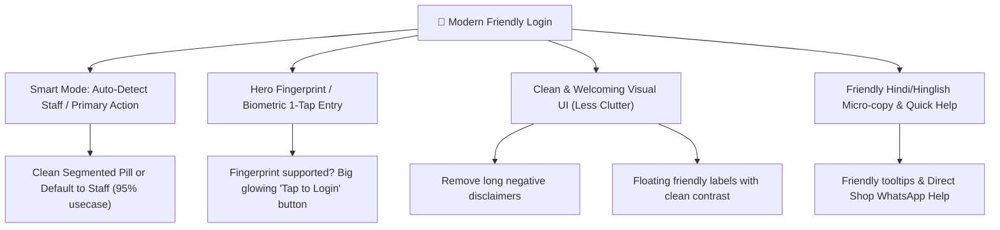

# Login Page Modernization & Friendly UX Architecture Plan

> **Target Route**: `src/app/(public)/login/page.tsx`
> **User Feedback**: "Login page thoda annoying hai, ise easy aur friendly banana hai."

---

## 1. Why Is the Current Login Page Annoying? (UX Friction Analysis)

Aapka feedback bilkul sahi hai! Current login screen ko analyze karne par ye 5 badi pareshaniyan (friction points) samne aayi hain:

1. **Staff vs Client Tab Confusion**:
   - Har bar page khulte hi upar 2 tabs aate hain: `[ Staff ]` aur `[ Client ]`. Dukan ke regular staff/admin ko roz-roz wahi tab dekhna padta hai.
   - Client ka OTP flow aur Staff ka password/biometric ek hi chote card me mix ho jata hai.
2. **Text & Disclaimers Ka Clutter**:
   - Niche lambe-chaude text likhe hain: *"Is browser/device par biometric support nahi hai"*, *"App me biometric available nahi hai Chrome me kholein"*, *"Email field tap karein browser passkey dikhayega..."*
   - Itna text padhne me user bore aur irritate hota hai.
3. **Password Re-typing on Mobile**:
   - Chote mobile keyboard par roz-roz lamba password type karna sabse zyada annoying hota hai.
   - Agar biometric (Fingerprint / Face Unlock) available hai, toh wo primary highlight hona chahiye, na ki chota secondary button.
4. **Visual Blandness & Cold Feeling**:
   - Dark card, chota input box aur text-heavy layout ek purana sa form lagta hai — welcoming ya modern web-app jaisa feel nahi deta.
5. **Clear Help / Forgot Password Missing**:
   - Agar staff password bhool gaya ya login nahi ho raha, toh turant support/help ka koi direct dostana button ya contact link nahi hai.

---

## 2. The Solution: Friendly, Clean & Modern UX ("Zero Friction Login")



---

## 3. Recommended Design Features & Sujhav

### A. One-Tap Biometric (Hero Fingerprint) 🌟
- Agar user ke phone/laptop me Fingerprint / Face Unlock set hai:
  - Form ke upar ek bada, elegant button:
    `[ 👆 Tap karke Fingerprint se Login karein ]`
  - User ko **bina email ya password type kiye 1 second me seedha Dashboard** par le jaye.
  - Password form niche "Ya password use karein" collapse/clean option ke sath rahe.

### B. Clean Segmented Switcher (No Heavy Borders)
- Staff vs Client tab ko ek smooth iOS-style capsule switcher me convert karna:
  `[ 👔 Dukaan Staff / Admin ]` | `[ 👤 Customer Portal ]`

### C. Remove Negative & Lengthy Disclaimers
- Lambe technical paragraphs ko hata kar smart, context-aware visual icons/pills lagana:
  - Technical: *"Is browser/device par biometric login support nahi hai..."* ❌ (Annoying)
  - Friendly: Agar biometric nahi hai, toh chup-chap sirf password box dikhao — faltu gyan na do! ✅ (Clean & Easy)

### D. Auto-Remember & Quick Avatar Preview
- Jab user ka email pehle se saved ho (`rememberMe = true`):
  - Ek chota friendly welcome chip:
    `"Namaste Vikram! 👋 [Not you? Change]"`
  - User ko sirf password enter karna ho ya fingerprint lagana ho.

### E. Helpful Quick Actions at the Bottom
- Customer ke liye:
  `[ 🔍 Bina login Job Status track karein → ]` (Attractive banner card)
- Staff ke liye:
  `[ ❓ Password bhool gaye? Shop Admin se sampark karein ]`

---

## 4. Proposed Layout Comparison

### Abhi Ka Annoying Form:
```
┌──────────────────────────────────────────────┐
│                  [Shield]                    │
│                V-TECH PRO                    │
│            MANAGEMENT SYSTEM                 │
│                                              │
│ [ Staff ]           [ Client ]               │
│ Staff Login                                  │
│ Login to manage your shop                    │
│                                              │
│ Email: [___________________________________] │
│ Password: [________________________________] │
│ [ ] Remember My Email                        │
│ [ Login to Dashboard                       ] │
│ ─────────────────── ya ────────────────────  │
│ [ Fingerprint se login karein              ] │
│ Is browser/device par biometric support nahi │
│ hai upar wala password use karein...         │
│                                              │
│ [ Track Job Status (No Login Required)     ] │
└──────────────────────────────────────────────┘
```

### Naya Modern Friendly Design:
```
┌──────────────────────────────────────────────┐
│                  ⚡ V-TECH                   │
│          "Welcome back! Apni dukan me        │
│                aapka swagat hai"             │
│                                              │
│   ( 👔 Staff / Admin )     ( 👤 Customer )   │
│                                              │
│ ┌──────────────────────────────────────────┐ │
│ │  👆 Quick Login with Fingerprint / Face  │ │
│ └──────────────────────────────────────────┘ │
│                                              │
│ ────────── ya password se login karein ───── │
│                                              │
│  Email:    [ staff@vtech.com               ] │
│  Password: [ ••••••••••••••              👁 ] │
│  [✓] Mujhe yaad rakhein                      │
│                                              │
│  [ Sign In to Dashboard  →                 ] │
│                                              │
│  🔍 Customer bina login status dekhein       │
└──────────────────────────────────────────────┘
```

---

## 5. Implementation Roadmap

1. **Step 1: UI Cleanup & Noise Removal**:
   - Negative error/unsupported paragraphs hatana.
   - Clean floating inputs with eye toggle.
2. **Step 2: Biometric Prominence**:
   - WebAuthn available hone par prominent One-Tap card highlight.
3. **Step 3: Friendly Customer Tab**:
   - OTP input box with auto-spacing and clean countdown for resend.
4. **Step 4: Mobile & PWA Polish**:
   - Touch targets 44px+ for comfortable thumb reach.
