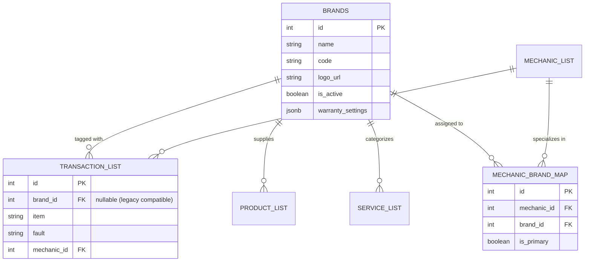

# Multi-Brand Service & Operations Architecture Plan

> **Target Concept**: Ek hi shared/core database me multiple brands (e.g., Brand A, Brand B, Generic) ke repair jobs, spare parts, services aur mechanics ko clean segregation aur dedicated views ke sath manage karna.

---

## 1. Executive Summary & Core Requirements

Aapki zaroorat ke mutabiq:
1. **Core DB ek hi rahega**: Alag-alag databases ya instances banane ki zaroorat nahi hai (single tenant multi-brand structure).
2. **Brand-Specific Item & Service Management**: Har brand ke apne models/items, dedicated spare parts, aur service charges track ho sakein.
3. **Mechanic Specialization & Cross-Brand Assignment**:
   - Koi mechanic kisi specific brand (jaise Brand X Authorized Specialist) ke liye dedicated assign ho sake.
   - Ya phir koi mechanic flexible / multi-brand (Brand X + Brand Y + Generic) par kaam kar sake.
4. **Seamless Isolation with Global Visibility**:
   - Admin chahe toh **All Brands** ka consolidated data dekhe ya **Single Brand filter** lagakar sirf usi brand ka dashboard, pending jobs, profit/revenue aur stock dekhe.

---

## 2. Recommended Additional Features (Expert Suggestions)

Jo cheezein real-world multi-brand service centers (jaise authorized EV/electronics workshops) me zaroori hoti hain aur aapke project ko next-level banayengi:

1. **Brand-Wise Job ID / Token Prefixing**:
   - Har brand ke liye optional custom prefix (e.g., `KMK-2801` for Komaki, `OLA-2802`, `GEN-2803`). Isse job sheets, print chalan aur WhatsApp updates me turant brand pehchan hoti hai.
2. **Warranty vs Out-of-Warranty (OOW) Tracking**:
   - Brand ke sath **Company Warranty Claim** ya **Standard Customer Paid** flag. Isse brand company ko monthly warranty billing chalan bhejna aasan ho jayega.
3. **Brand-Specific Commission & Rate Matrix**:
   - Agar Brand A ke repairs technical hain toh mechanic ko ₹X ya Y% alag commission, aur Brand B par standard commission.
4. **Brand-Filtered Customer Portals & Receipts**:
   - Print bill aur WhatsApp message me brand logo / service header dynamically print hona (e.g., *"Authorized Service for [Brand]"*).
5. **Brand Stock Reconciliation & Low Stock Alerts**:
   - Brand specific genuine parts vs local/generic compatible parts ka alag ledger.

---

## 3. Database Architecture (Backward Compatible)

Purane (PHP-era) data ko disturb kiye bina additive (non-breaking) design:

### Proposed Schema Changes:

1. **New Table: `brands`**
   - `id SERIAL PRIMARY KEY`
   - `name TEXT NOT NULL` (e.g., "Komaki", "Ola Electric", "Generic / Multi-Brand")
   - `code VARCHAR(20) UNIQUE` (e.g., "KMK", "OLA", "GEN")
   - `logo_url TEXT`
   - `support_phone TEXT`, `support_email TEXT`
   - `is_active BOOLEAN DEFAULT TRUE`
   - `date_created TIMESTAMPTZ DEFAULT NOW()`

2. **New Table: `mechanic_brand_map` (Many-to-Many)**
   - `mechanic_id INT REFERENCES mechanic_list(id) ON DELETE CASCADE`
   - `brand_id INT REFERENCES brands(id) ON DELETE CASCADE`
   - `is_primary BOOLEAN DEFAULT FALSE`
   - `notes TEXT`
   - `PRIMARY KEY (mechanic_id, brand_id)`
   *(Agar koi mechanic kisi brand se map nahi hai, toh by default wo "All Brands / General" handle karega).*

3. **Additive Columns in Existing Tables**:
   - `transaction_list.brand_id INT NULL REFERENCES brands(id)` (Existing jobs `NULL` rahenge jo General/Legacy treat honge).
   - `product_list.brand_id INT NULL REFERENCES brands(id)` (Brand-specific spare parts vs universal spares).
   - `service_list.brand_id INT NULL REFERENCES brands(id)` (Brand-specific labor rates).

---

## 4. UI/UX Workflow & Segregation Experience

### A. Top Global Brand Switcher (Header Pill)
- Navbar me ek clean drop-down / badge:
  `[ 🌐 All Brands ▾ ]` | `[ ⚡ Komaki ]` | `[ 🛵 Ola ]` | `[ 🔧 Generic ]`
- Switcher change karte hi poori application (Jobs list, Inventory, Reports) us brand ke context me filter ho sakti hai, ya All Brands dekh sakte hain.

### B. New Job Intake (`/jobs/new`)
- **Brand Selection**: User dropdown se Brand select karega (ya item select karte hi brand auto-suggest hoga).
- **Smart Mechanic Dropdown**:
  - Jab brand select hoga, toh dropdown me pehle **Brand Specialists** highlight honge:
    - *Rahul Sharma (Komaki Certified Specialist)*
    - *Amit Verma (General Mechanic)*
  - Agar mechanic kisi aur brand par busy hai ya allowed nahi hai, toh validation warning/indicator milega.

### C. Mechanics Profile (`/mechanics`)
- Mechanic edit modal me **"Brand Specializations"** checkboxes (multi-select):
  - `[x] Komaki`
  - `[x] Ola`
  - `[ ] Generic / Others only`
- Isse ek mechanic 1 brand ya 5 brands sabhi me assign ho sakega.

### D. Inventory & Services (`/products` & `/services`)
- Catalog tables me ek **"Brand"** column aur quick filter tabs.
- Job view ke andar spares add karte waqt selected brand ke compatible parts top par dikhenge.

---

## 5. Phased Implementation Roadmap

| Phase | Milestone | Scope |
|---|---|---|
| **Phase 1: Database Foundation** | DB Tables & Migration | `brands`, `mechanic_brand_map` tables banana, idempotency script update, RLS audit. |
| **Phase 2: Master Settings & Brand CRUD** | Settings UI | `/settings/brands` page jahan Admin brands add/edit/disable kar sake. |
| **Phase 3: Mechanic Multi-Assignment** | Mechanics UI | Mechanic form me multi-brand selection add karna + query filter helpers. |
| **Phase 4: Jobs Flow Integration** | Job Intake & View | `/jobs/new` aur `/jobs/[id]/view` me `brand_id` capture karna aur brand specialist auto-filter. |
| **Phase 5: Brand-wise Reports & Filters** | Analytics & Accounting | Dashboard, Pending Jobs aur Balance sheet me Brand filter add karna. |

---

## 6. Feedback & Decisions Needed

1. **Auto-Brand Detection**: Kya item name (e.g. "Komaki XGT") likhne par brand automatically detect ho ya drop-down hamesha manual choose karna hai?
2. **Strict Assignment**: Kya mechanic assignment strict hona chahiye (yani Komaki job sirf Komaki-mapped mechanic ko hi assign ho sake) ya flexible recommendation (sirf preferred mechanic upar dikhe)?
